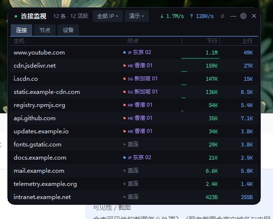
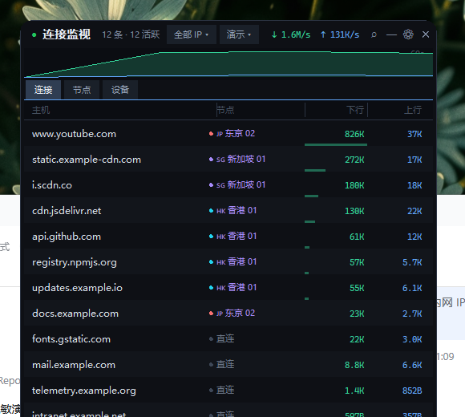
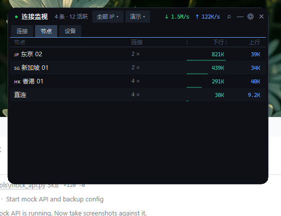
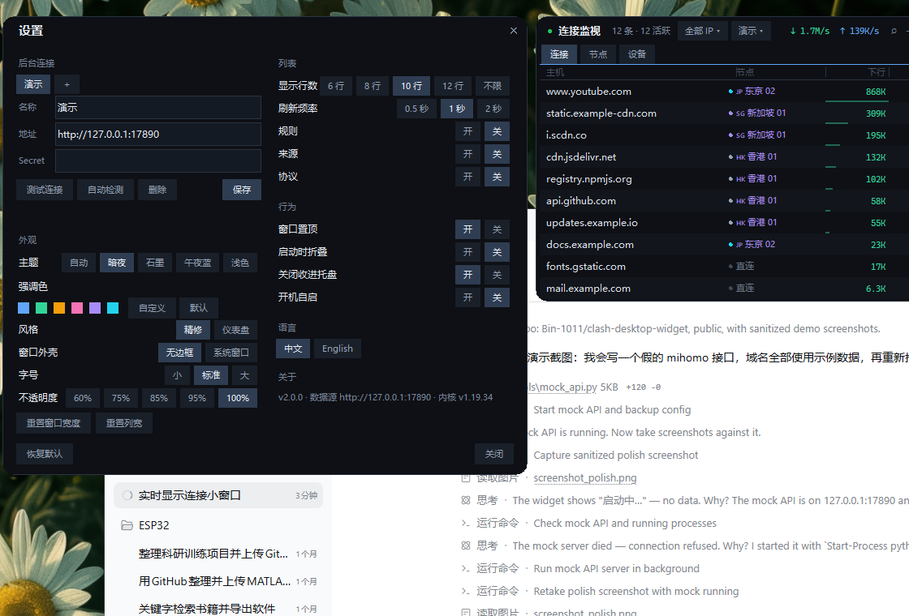
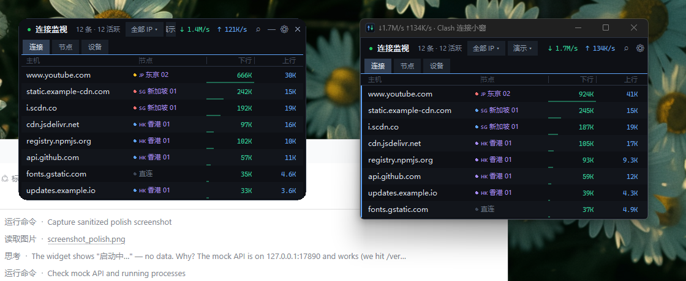

# Clash 连接小窗 · Clash Desktop Widget

一个常驻桌面的 Clash / mihomo 实时连接监视小窗（Windows，Python + Tkinter，无第三方依赖）。

每秒刷新、按速率排序，点一下就能看规则 / 链路 / 来源；支持任意后台地址、多配置档、
不限行数滚动、按节点和设备汇总、搜索排序、托盘常驻，也能打包成免 Python 的单文件 exe。



## 特性

**连接视图**
- 只显示有网络活动的连接，按实时速率排序；空闲连接以灰字补位，窗口不会空
- 三档视图：**连接 / 节点 / 设备**（按出口节点或来源 IP 汇总速率与连接数）
- 列：主机、节点（带彩色圆点）、下行、上行，可加显示 规则 / 来源 / 协议
- 列宽可拖动、双击边界按内容自适应、点表头排序、搜索过滤（Ctrl+F）
- 单击行看详情（规则、链路、来源、协议、累计流量），右键复制 / 只看该 IP / 只看该节点
- 行数可选 6/8/10/12 或**不限**：切到「不限」不会改变窗口高度，只改为可滚动，鼠标移到右侧浮出细滑块，滚轮浏览；拖底边可调高

**外观**
- 两套风格：**精修**（紧凑）/ **仪表盘**（大行高 + 60 秒速率曲线，可切 5m / 30m）
- 五档主题：**自动**（跟随 Windows 深浅色）/ 暗夜 / 石墨 / 午夜蓝 / 浅色
- **强调色**可换：预设色 + 自定义取色，作用于表头线、活跃行色条、排序箭头等
- 两种窗口外壳：**无边框**（默认，自绘圆角）/ **系统窗口**（系统标题栏、任务栏、贴边、Alt+Tab）
- 字号、不透明度、迷你模式（只显示大号速率 + 连接数 + 首条主机）

**连接能力**
- 多配置档（家里 / 公司 / 路由器），地址容错（粘贴 `/ui/#/connections` 也能识别）、https、路径前缀、Secret
- **测试连接**、**自动检测**（扫本机与默认网关的 9090/9999/9091/6170）
- 首次启动引导；断连诊断（401 / 404 / 超时 / 拒绝连接）
- **WebSocket 实时流**优先（mihomo 每秒推送），失败自动回退 HTTP 轮询

**系统集成**
- 托盘图标（纯 ctypes）、关闭收进托盘、开机自启（写入 `shell:startup`）
- 全局快捷键 `Ctrl+Shift+C` 呼出 / 收起；单实例，重复启动会把已有窗口叫到前面

## 截图

| 精修（默认） | 仪表盘 |
|---|---|
|  |  |

| 节点汇总视图 | 设置 |
|---|---|
|  |  |

| 窗口外壳：左=无边框，右=系统窗口 |
|---|
|  |

## 快速开始

| 方式 | 说明 |
| --- | --- |
| 双击 `ClashConnWidget.exe` | 单文件打包版，不用装 Python（约 12.6 MB） |
| 双击 `启动小窗.vbs` | 有 exe 用 exe，否则 `pythonw conn_widget.py` |
| `创建桌面快捷方式.ps1` | 在桌面生成带图标的快捷方式 |

首次启动会弹出引导：填 Clash 外部控制器地址（如 `http://192.168.50.1:9999`），
点「自动检测」可自动找本机 / 网关上的常见端口。

源码运行需要 Python 3.10+（仅标准库）：

```powershell
pythonw conn_widget.py --api http://192.168.50.1:9999 --secret your-secret
```

## 操作

| 操作 | 说明 |
| --- | --- |
| 顶栏圆点 | 绿=正常，红=断开；点它看诊断 |
| 「全部 IP ▾」 | 按来源 IP 过滤 |
| 「配置档 ▾」 | 切换后台 |
| 视图 tab | 连接 / 节点 / 设备 |
| 「⌕ 搜索」或 Ctrl+F | 搜索主机 / 节点（按钮在视图栏右侧） |
| Ctrl+Shift+C | 全局呼出 / 收起 |
| 点表头 | 排序；拖动列边界改宽；双击边界自适应 |
| 单击 / 双击行 | 详情 / 复制主机名 |
| 右键行 | 复制、只看该 IP、只看该节点 |
| 窗口边缘 | 左右拖动改整窗宽度、底边拖动改高度（无边框模式；拖底边会自动切到「不限」） |
| `—` / `✕` | 折叠 / 关闭（默认进托盘） |

## 设置


- **后台连接**：配置档增删切换、名称/地址/Secret、测试连接、自动检测
- **外观**：主题、强调色、风格、窗口外壳、字号、不透明度、重置窗口宽度/列宽
- **列表**：显示行数（含不限）、刷新频率、列显示开关（规则/来源/协议）
- **行为**：置顶、启动时折叠、关闭收进托盘、开机自启
- **语言**：中文 / English
- **关于**：版本、仓库地址（可点击）、作者、运行环境、数据源与内核版本，以及「检查更新」

## 实时性

优先用 WebSocket 订阅 `/connections`（mihomo 每秒推全量快照），省掉每秒 HTTP 建连；
握手失败或断开会自动回退 HTTP 轮询，连续失败 3 次本次运行只用轮询。

## 常见问题

- **API 未连接**：确认 `http://<host>:9999/version` 浏览器能打开；若 Clash 只监听
  `127.0.0.1`，需要把 `external-controller` 改成 `0.0.0.0:9999` 并放行防火墙。
- **401**：后台设置了 `secret`，在设置里填入并保存。
- **404**：地址不是 Clash 接口，检查端口或路径前缀（如 `https://host/clash`）。
- **关闭后找不到窗口**：默认收进托盘，双击托盘图标或右键「显示窗口」。
- **支持内核**：mihomo / Clash.Meta 及兼容 Clash 外部控制器 API 的实现。

## 开发

```
conn_widget.py        主程序（界面 + 轮询 + 托盘，纯标准库）
tools/mock_api.py     本地假 mihomo 接口，用于截图 / 演示
build.ps1             重新打包单文件 exe（需 PyInstaller）
make_icon.ps1         生成 app.ico
```

本地演示（无需真实 Clash）：

```powershell
python tools/mock_api.py            # http://127.0.0.1:17890
python conn_widget.py --api http://127.0.0.1:17890
```

打包：

```powershell
python -m pip install pyinstaller
.\build.ps1
```

## 文件

| 文件 | 作用 |
| --- | --- |
| `ClashConnWidget.exe` | 单文件打包版 |
| `conn_widget.py` | 源码（约 3000 行） |
| `启动小窗.vbs` / `创建桌面快捷方式.ps1` | 启动器 / 快捷方式 |
| `app.ico` / `make_icon.ps1` / `build.ps1` | 图标与构建脚本 |
| `widget_state.json` | 运行时配置（自动生成，已 gitignore） |

## 版本与更新

当前版本 **v3.0.1**。发布版本在 [Releases](https://github.com/Bin-1011/clash-desktop-widget/releases)，
程序里「设置 → 关于 → 检查更新」会读取 GitHub 最新 Release 并对比版本号。

## License

MIT
